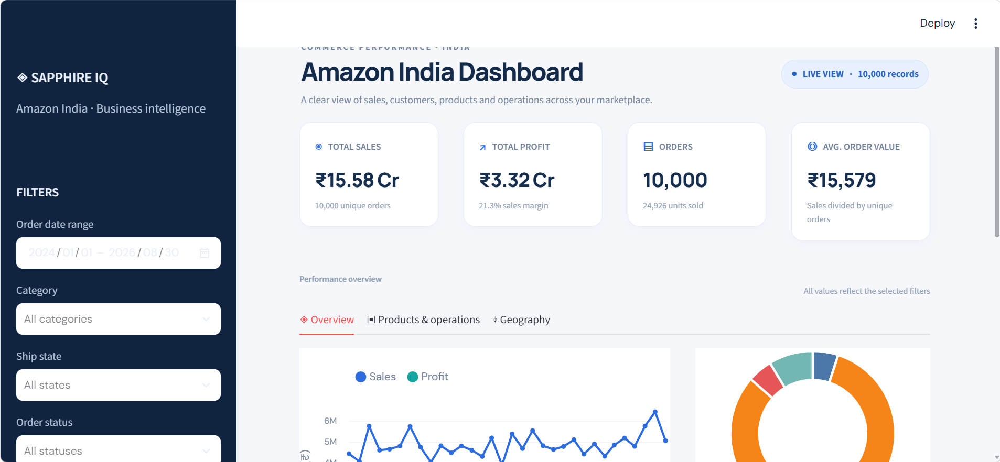

# Amazon India Sales Dashboard

An interactive Streamlit dashboard for exploring Amazon India order performance. It turns the supplied sales dataset into a management view of sales, profitability, products, order outcomes, payment and fulfillment channels, and state level performance.

## Dashboard features

- Filter the dashboard by order date, product category, shipping state, and order status.
- Track total sales, total profit, total orders, units sold, average order value, and profit margin.
- Compare monthly sales and profit trends.
- Review delivered, shipped, returned, and cancelled orders, including return and cancellation rates.
- Compare category sales, profit, units sold, and returns/cancellations.
- Explore the top 10 products by sales.
- Compare sales and profit by payment method, fulfillment method, and shipping state.

All charts and summary values respond to the selected filters.

## Dashboard preview



## Run locally

Install Python 3.10 or newer. From the repository folder, install the project dependencies and start the dashboard:

```powershell
python -m pip install -r outputs/requirements.txt
python -m streamlit run outputs/app.py
```

The app opens in your browser at the local address shown in the terminal. The dashboard reads `amazon_sales.csv` from the same folder as `app.py`.

## Jupyter analysis

Open `outputs/amazon_india_analysis.ipynb` in Jupyter and run the cells from top to bottom. It reads the included Excel workbook and reproduces the main KPI, trend, category, product, order status, payment, fulfillment, and state analyses.

```powershell
python -m pip install -r outputs/requirements.txt
python -m jupyter notebook outputs/amazon_india_analysis.ipynb
```

## Repository contents

```text
outputs/
  app.py             Streamlit dashboard
  amazon_sales.csv   Dashboard data
  Amazon Sales Data India.xlsx  Source workbook
  amazon_india_analysis.ipynb   Exploratory analysis
  dashboard_preview.png         Dashboard screenshot
  requirements.txt              Python dependencies
  README.md                     Quick run notes
```

## Data and metric notes

The included CSV was prepared from the supplied Amazon Sales Data India workbook. It contains 10,000 order records and fields for order date, category, product, quantity, sales, profit, payment method, fulfillment, order status, and shipping state.

- Average order value = total sales / unique orders.
- Profit margin = total profit / total sales.
- Return and cancellation rates use all filtered orders as the denominator.
- Sales values shown for returned or cancelled orders are indicators of the recorded order value, not confirmed accounting losses. The source data does not contain accounting adjustments for refunds or cancellations.

## Technology

Python · Streamlit · pandas · Altair
